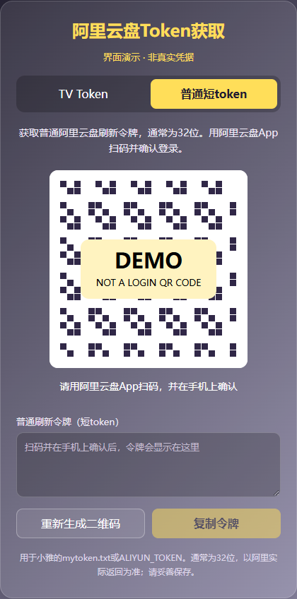
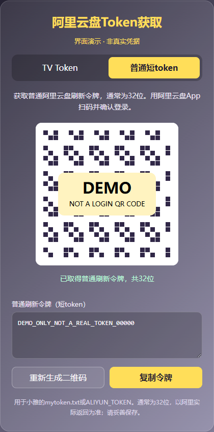
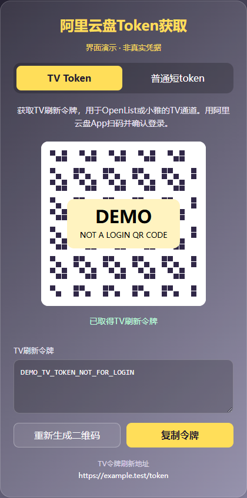

# 阿里云盘Token获取服务（普通 / TV）

基于[lilu0826/alitv_openlist](https://github.com/lilu0826/alitv_openlist)维护，当前仓库为[gagabba/alitv_openlist](https://github.com/gagabba/alitv_openlist)。一个页面提供普通阿里云盘和TV两种扫码入口，支持Railway、Docker和本地Go运行。

普通扫码已在Railway完成真实账号验证，取得32位refresh_token并实际使用正常。令牌长度以阿里云盘实际签发为准，程序不会截断或修改它。

## 选择入口

| 页面入口 | 返回的令牌 | 小雅对应配置 |
|---|---|---|
| `/`或`/#tv`（默认） | TV刷新令牌 | `ALIYUN_OPEN_TOKEN` / `myopentoken.txt` |
| `/#basic` | 普通阿里云盘refresh_token，常称32位短token | `ALIYUN_TOKEN` / `mytoken.txt` |

1. 打开自己部署的服务，选择普通或TV标签。
2. 用阿里云盘App扫码，核对并确认登录。
3. 点击复制，将完整令牌填入对应应用。两类令牌不能互换。
4. 二维码过期或取消后，点击重新生成。重启或重新部署后也需要重新扫码。

以下截图使用合成演示数据，二维码不是登录链接，显示的文字不是有效令牌，不包含真实账号或个人部署地址。

| 普通扫码页面 | 普通令牌结果 | TV令牌结果 |
|---|---|---|
|  |  |  |

普通扫码功能位于根目录Go服务，适用于Railway、Docker和本地运行。`api/`是旧Vercel实现，仅保留原TV功能；本README不将它视为普通扫码部署入口。

## Railway部署与8080端口

从**本仓库**的`main`分支部署，使用根目录`Dockerfile`。本项目的Railway实例已在8080端口正常使用，以下以8080为配置示例：

| 配置项 | 设置 |
|---|---|
| 构建方式 | 根目录`Dockerfile` |
| 启动命令 | 使用镜像默认命令`./app`，不需要另填 |
| `PORT` | 可显式设为`8080`，也可使用平台注入值 |
| 域名Target Port | 与实际`PORT`一致；使用`PORT=8080`时填`8080` |
| 数据库、持久卷 | 本服务不需要 |

公网访问使用Railway生成的HTTPS域名，例如`https://your-service.up.railway.app/`；**不要在域名后追加`:8080`或`:8081`**。容器监听端口与浏览器访问的HTTPS端口是不同层次。

### 为什么原项目写8081，Railway上却是8080？

当前`main.go`的规则是：优先使用环境变量`PORT`，只有变量未设置或为空时才回退到`8081`。因此：

- 本地直接运行、没有`PORT`：监听8081。
- 环境中`PORT=8080`：监听8080，覆盖本地默认值。
- Dockerfile中的`EXPOSE 8081`：描述默认端口，不设置`PORT`，也不会强制程序监听8081。

Railway会注入`PORT`，也允许显式设置。具体实例的8080来自自动注入还是手工配置，应以该服务的Variables及部署设置为准，不能只根据Dockerfile判断。已经正常工作的8080配置可以继续使用，无需为了旧文档改回8081。

出现502时，先核对应用实际`PORT`与域名Target Port是否一致。服务还需要能访问阿里云盘的HTTPS接口；普通扫码使用`passport.aliyundrive.com`。

参考：[Railway端口排查](https://docs.railway.com/networking/troubleshooting/application-failed-to-respond)、[Docker的EXPOSE说明](https://docs.docker.com/reference/dockerfile/#expose)。

## 本地运行

安装满足`go.mod`要求的Go环境（至少Go1.24.5）。

```sh
git clone https://github.com/gagabba/alitv_openlist.git
cd alitv_openlist
go mod download
go run .
```

没有设置`PORT`时，访问`http://localhost:8081/`；普通入口为`http://localhost:8081/#basic`。

需要与Railway一样使用8080时，PowerShell运行：

```powershell
$env:PORT = '8080'
go run .
```

Linux/macOS运行：

```sh
PORT=8080 go run .
```

此时访问`http://localhost:8080/`。变量只需在启动进程的环境中设置，程序不会自动读取`.env`文件。

## Docker部署

从本仓库源码构建，确保包含普通扫码功能；上游镜像和上游Release不能替代本仓库当前源码。

```sh
docker build -t alitv_openlist:local .
docker run -d --name alitv_openlist --restart unless-stopped -e PORT=8080 -p 127.0.0.1:8080:8080 alitv_openlist:local
```

访问`http://localhost:8080/`。该示例只向本机发布端口，公网部署请通过HTTPS反向代理访问。

如需沿用旧的8081方式，省略`-e PORT=8080`，将映射改为`-p 127.0.0.1:8081:8081`。端口映射右侧必须对应容器内实际监听端口。

## OpenList / AList的TV刷新设置

在使用TV令牌的驱动中填入TV扫码结果，并按驱动要求启用在线API，将OAuth/令牌刷新地址设为`https://your-service.up.railway.app/token`。OpenList/AList所在机器必须能访问该地址。

`/token`是**TV令牌刷新接口**，不能用来刷新普通短token。兼容情况、会员权益和下载速度以阿里云盘及所用驱动的实际行为为准。

## 接口说明

| 方法与路径 | 用途 |
|---|---|
| `POST /basic/qr` | 创建普通扫码会话并生成二维码 |
| `POST /basic/check` | JSON请求体`{"session_id":"生成接口返回的值"}`，查询普通扫码状态 |
| `GET /qr`、`GET /check` | 原TV扫码流程 |
| `POST /token` | TV刷新；表单或JSON字段`refresh_token` |
| `GET /token` | 兼容旧客户端的TV刷新；查询参数`refresh_ui` |

普通扫码状态包含`NEW`、`SCANED`、`EXPIRED`、`CANCELED`和`CONFIRMED`。确认后仅返回状态、普通`refresh_token`及实际`token_length`，不返回完整登录资料。

## 隐私与仓库文件

- 普通扫码的会话和上游Cookie临时保存在内存，每个会话最长有效5分钟，并在到期时自动清理；成功、取消或检查到过期时立即清理。
- 根目录服务不将令牌保存到数据库、文件或浏览器持久存储；普通扫码响应和首页使用`no-store`，应用不打印令牌或完整请求URL。页面仍需在内存中显示令牌供本人复制。
- 优先使用HTTPS和`POST /token`。旧客户端使用GET时，查询参数可能进入客户端历史、代理或平台访问日志；应用自身关闭请求日志不能控制这些外部日志。
- 本服务没有额外的访问密码。对外部署时按需要在反向代理或平台侧限制访问；令牌本身按账户凭据保管。
- `.gitignore`排除本机协作记录、环境文件、凭据导出、日志、备份、缓存和编译产物。公共README只使用示例地址，不收录个人部署网址、本机路径或双账号配置。
- `.dockerignore`只允许当前Go服务构建必需的源码和依赖清单进入构建上下文，防止`COPY . .`带入本机私有文件。
- 忽略规则不会清除已经提交的内容或Git历史。提交前仍需检查`git status`和暂存区差异；如曾误传真实凭据，应撤销或轮换凭据，再单独处理历史。

## 验证

```sh
go test ./...
go vet ./...
go build -o bin/alitv_openlist .
```

自动测试使用合成数据，覆盖普通扫码成功、Cookie隔离、会话清理、容量限制和错误处理。真实扫码依赖阿里云盘接口及账户状态；无需将实际令牌提交到测试、日志、Issue或截图中。
